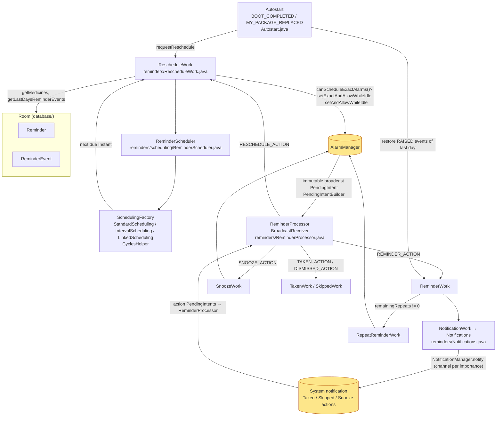

# Reminder scheduling & notification architecture (DRAFT — EE-30)

**Status: DRAFT for human review.** Describes the module as of branch `devin/ee-30-android17-reminders`
(`compileSdk`/`targetSdk` 37, `minSdk` 28). Paths are relative to `app/src/main/java/com/futsch1/medtimer/`.

## Flow: alarm → receiver → WorkManager → notification

Yellow nodes are Android OS services; everything else is app code. All work items run on WorkManager
(`WorkManagerAccess` configures a single-thread `IdlingThreadPoolExecutor`).

## Where the OS-version-specific code lives

| Concern | Location | API gate | Android 16/17 relevance (see `docs/upgrade-impact-android-17-reminders.md`) |
|---|---|---|---|
| Exact vs. inexact alarm | `reminders/RescheduleWork.java` `enqueueNotification` / `canScheduleExactAlarms` | `Build.VERSION_CODES.S` (31) + `AlarmManager.canScheduleExactAlarms()` + preference `exact_reminders` | IMP-20 — unchanged; now covered by `RescheduleWorkExactAlarmUnitTest`, `SnoozeWorkBoundsUnitTest` |
| `SCHEDULE_EXACT_ALARM` / `USE_EXACT_ALARM` permission UI | `preferences/` (exact reminders switch), `MainActivity` permission prompts | 31+ / 33+ | IMP-20 |
| `POST_NOTIFICATIONS` runtime permission | `MainActivity` / `MedTimerAppIntro.kt` | 33+ (`TIRAMISU`) | IMP-21 — unchanged |
| Notification channels, importance, full-screen intent | `reminders/Notifications.java`, `NotificationChannelManager` | 26+ (channels), 34+ (`USE_FULL_SCREEN_INTENT` restrictions) | IMP-24, IMP-11 (no custom `RemoteViews` → memory limit N/A) |
| PendingIntent mutability | `reminders/PendingIntentBuilder.java` (`FLAG_IMMUTABLE | FLAG_UPDATE_CURRENT`) | 31+ requirement | IMP-22 — unchanged |
| Receiver export + intent filter (Safer Intents) | `AndroidManifest.xml` `<receiver .reminders.ReminderProcessor exported=false>` | 16/17 enforcement for `targetSdk` ≥ 36 | **IMP-07 — `SNOOZE_ACTION` added to the filter on this branch**; guarded by `ReminderProcessorIntentUnitTest#test_allReminderProcessorActionsDeclaredInManifestFilter` |
| Boot / package-replaced receiver | `Autostart.java`, manifest `RECEIVE_BOOT_COMPLETED` | — | IMP-23 — unchanged; `AutostartUnitTest` |
| WorkManager / JobScheduler quotas | `WorkManagerAccess.java`, all `*Work` classes (expedited work not used) | 16 quota changes | IMP-01 — runtime check on emulator |
| Edge-to-edge / predictive back (snooze dialog, main UI) | `MainActivity`, themes; `android:enableOnBackInvokedCallback="true"` | 15/16 | IMP-05 / IMP-06 — UI check only |

## Build / toolchain (after EE-30)

Gradle 9.8.1 · AGP 9.4.1 (built-in Kotlin) · JDK 17 · `compileSdk 37` · `targetSdk 37` · `minSdk 28` ·
WorkManager 2.12.0 · Room 2.8.5 · Robolectric 4.17 (JVM tests pinned to `sdk = 34`).
