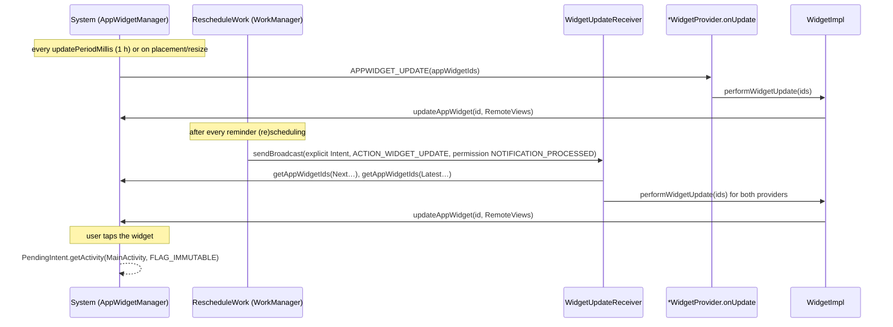

# MedTimer home-screen widgets — architecture (DRAFT for human review)

Scope: package `com.futsch1.medtimer.widgets` as of EE-31 (compileSdk/targetSdk 37). This is a
description of the code as it is, written as an input for reviewers; it is not a design
specification and claims no conformity with any standard.

## Components

| Component | File | Role |
|---|---|---|
| `NextRemindersWidgetProvider`, `LatestRemindersWidgetProvider` | `NextRemindersWidgetProvider.kt`, `LatestRemindersWidgetProvider.kt` | `AppWidgetProvider`s declared in `AndroidManifest.xml` with `android.appwidget.action.APPWIDGET_UPDATE`; `onUpdate()` delegates to `performWidgetUpdate()`. `getNextReminderWidgetImpl()` / `getLatestReminderWidgetImpl()` wire the provider-specific `WidgetLineProvider` and `WidgetIds` (root view id, 4-line layout, 1-line layout). |
| `WidgetUpdateReceiver` | `WidgetUpdateReceiver.kt` | App-internal `BroadcastReceiver` (`exported="false"`, action `WidgetUpdateReceiver.ACTION_WIDGET_UPDATE` = `com.futsch1.medtimer.WIDGET_UPDATE`). Looks up all placed ids of both providers via `AppWidgetManager.getAppWidgetIds` and refreshes them. |
| `WidgetLineProvider` (+ `NextRemindersLineProvider`, `LatestRemindersLineProvider`) | `WidgetLineProvider.kt` | Turn Room data into one text line per widget row. Data is loaded once per provider instance on a background coroutine (`loadScheduledRemindersFromRepository` / `loadLatestReminderEventsFromRepository`); `getWidgetLine(n)` joins that job and formats row `n` or returns `""`. |
| `WidgetImpl` | `WidgetImpl.kt` | Builds the `RemoteViews`: a 4-line layout (`LARGE_WIDGET_LINES`) and a 1-line layout (`SMALL_WIDGET_LINES`), each row an inflated `widget_line.xml` added to `widgetLine1..4`; empty rows are `INVISIBLE`. On API 31+ both are wrapped in a size-mapped `RemoteViews` (`SizeF(110,50)` → small, `SizeF(110,150)` → large). The root gets an immutable activity `PendingIntent` to `MainActivity`. |
| Widget metadata | `res/xml/next_reminders_widget_info.xml`, `res/xml/latest_reminders_widget_info.xml` | `minWidth 200dp`, `minHeight 45dp`, `maxResizeWidth 600dp`, `targetCellWidth 3`, `targetCellHeight 1`, `resizeMode horizontal|vertical`, `updatePeriodMillis 3600000`, `previewLayout`, `widgetCategory home_screen`. |
| Layouts | `res/layout/*widget*.xml` | Standard `LinearLayout` / `TextView` / `ImageView` only (RemoteViews-compatible); caption shows the app icon via `@mipmap/logo_round` **as a resource reference**, never as a `Bitmap`. |

## Data flow

```mermaid
flowchart LR
    subgraph Data["Room database"]
        MR[MedicineRepository]
    end
    subgraph Providers["Line providers (WidgetLineProvider.kt)"]
        NRLP[NextRemindersLineProvider<br/>medicines + reminder events<br/>→ ReminderScheduler.schedule()]
        LRLP[LatestRemindersLineProvider<br/>getLastDaysReminderEvents(7).reversed()]
    end
    subgraph Impl["WidgetImpl.kt"]
        BL[buildLargeRemoteViews()<br/>4 × widget_line]
        BS[buildSmallRemoteViews()<br/>1 × widget_line]
        BR[buildRemoteViews()<br/>API 31+: SizeF map]
    end
    AWM[AppWidgetManager.updateAppWidget]
    HOST[Launcher / widget host]

    MR --> NRLP
    MR --> LRLP
    NRLP -- "getWidgetLine(0..3)" --> BL
    NRLP -- "getWidgetLine(0)" --> BS
    LRLP -- "getWidgetLine(0..3)" --> BL
    LRLP -- "getWidgetLine(0)" --> BS
    BL --> BR
    BS --> BR
    BR --> AWM --> HOST
```

## Refresh paths



## Android-version-dependent behaviour (after EE-31)

| Topic | Behaviour | Where |
|---|---|---|
| Size-mapped RemoteViews | API ≥ 31 (`Build.VERSION_CODES.S`): `RemoteViews(Map<SizeF, RemoteViews>)`; older: small layout only | `WidgetImpl.buildRemoteViews()` |
| Android 17 RemoteViews memory limit (targetSdk 37) | Bitmaps/Icons in the parcel must stay below `1.5 × screenW × screenH × 4` bytes, otherwise `updateAppWidget` throws. The widgets carry no Bitmap/Icon; `WidgetImplTest.sizedRemoteViewsParcelStaysFarBelowAndroid17BitmapLimit` guards it. | `WidgetImpl` KDoc, `WidgetImplTest` |
| `PendingIntent` mutability | explicit `FLAG_IMMUTABLE` (API 23+ flag, mandatory since API 31) | `WidgetImpl.getOpenAppPendingIntent()` |
| Refresh latency | WorkManager-driven refresh may be deferred under Android 16 job quotas; system period (1 h) is the floor | `RescheduleWork.updateNextReminderWidget()`, `*_widget_info.xml` |
| Large-screen changes (API 36/37) | Not applicable to widgets; sizing is launcher-driven via `appwidget-provider` attributes | `docs/upgrade-impact-android-17-widgets.md` IMP-03 |

## Tests

JVM: `WidgetLineProviderTest`, `WidgetImplTest`, `WidgetUpdateReceiverTest` (JUnit 5 + Robolectric,
see `docs/upgrade/test-evidence.md`). Instrumented/emulator evidence: `docs/upgrade/evidence/`.
