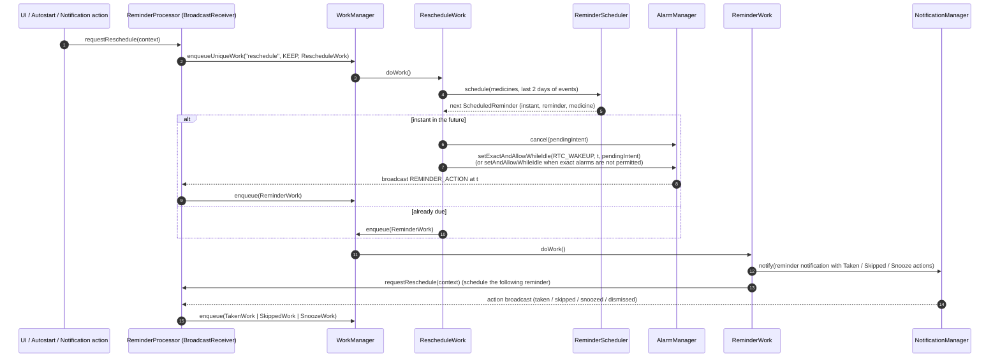

# MedTimer — Architecture overview

**Status: DRAFT for human review** (written for ticket [EE-32](https://cog-gtm.atlassian.net/browse/EE-32), Android 17 upgrade). This document describes the code as found in the repository; it makes no claim of compliance with IEC 62304, FDA guidance or any other standard.

## 1. Components (single Gradle module `app`, package `com.futsch1.medtimer`)

| Component | Files | Responsibility |
|---|---|---|
| UI shell | `MainActivity.java`, `res/layout/activity_main.xml`, `res/navigation/*` | Single-activity app; Material toolbar + `BottomNavigationView`; AndroidX Navigation between Overview, Medicines, Statistics; predictive back via `OnBackPressedCallback`; edge-to-edge insets handling (IMP-01) |
| App lock | `Biometrics.kt` | Optional `BiometricPrompt` gate before `MainActivity.start()` |
| Onboarding | `MedTimerAppIntro.kt`, `RequestPostNotificationPermission` | First-run intro (AppIntro), `POST_NOTIFICATIONS` request |
| Medicines & reminders UI | `medicine/*`, `overview/*`, `statistics/*`, `preferences/*` | Fragments/dialogs for medicines, reminders (standard, interval, linked), overview of events, charts/calendar, settings |
| Database | `database/*` (Room: `MedicineRoomDatabase`, `MedicineDao`, entities `Medicine`, `Reminder`, `ReminderEvent`, `Tag`, …; `MedicineRepository`) | Persistence; schemas under `app/schemas/` |
| Backup / export | `BackupManager.java`, `database/JSONBackup.java` (+ `JSONMedicineBackup`, `JSONReminderEventBackup`), `exporters/*`, `helpers/FileHelper.java` | JSON backup/restore (Gson with reflective field-completeness check), CSV/PDF export, sharing via `FileProvider` |
| Scheduling engine | `reminders/scheduling/*` (`ReminderScheduler`, `StandardScheduling`, `IntervalScheduling`, `LinkedScheduling`, `CyclesHelper`), `reminders/WeekendMode.java` | Pure logic that computes the next reminder instants from medicines, reminders and past events (JVM-testable) |
| Alarm & notification pipeline | `reminders/RescheduleWork.java`, `ReminderProcessor.java`, `PendingIntentBuilder.java`, `ReminderWork.java`, `Notifications.java`, `NotificationAction.java`, `SnoozeWork`, `TakenWork`, `SkippedWork`, `RepeatReminderWork`, `StockHandlingWork`, `NotificationSoundManager.kt` | WorkManager workers that schedule exact alarms, post notifications and process notification actions |
| Autostart | `Autostart.java` | `BOOT_COMPLETED` / `MY_PACKAGE_REPLACED` receiver: re-requests scheduling and re-posts raised reminders |
| Foreground helper | `ReminderSchedulerService` | Short-lived service used around rescheduling |
| Widgets | `widgets/*` (`WidgetImpl.kt`, `NextRemindersWidgetProvider.kt`, `LatestRemindersWidgetProvider.kt`, `WidgetUpdateReceiver`) | Home-screen widgets built from `RemoteViews` (text lines only) |
| WorkManager access | `WorkManagerAccess.java` | Single-threaded WorkManager configuration shared by app and tests |

## 2. Reminder → alarm → notification flow

Key properties:

- **One pending alarm at a time.** `RescheduleWork` always computes only the *next* reminder and (re)sets a single `PendingIntent` (request code = reminder event id; cancelling id 0 clears the "next" alarm).
- **Exact vs inexact alarms.** `RescheduleWork.canScheduleExactAlarms()` combines the user preference `exact_reminders` with `AlarmManager.canScheduleExactAlarms()` (API 31+). Unit tests: `RescheduleWorkUnitTest`.
- **Recovery.** `Autostart` re-requests a reschedule and re-posts `RAISED` events of the last day after reboot or app update. Unit tests: `AutostartUnitTest`.
- **Widgets** are refreshed by a broadcast (`NEXT_REMINDER_WIDGET_UPDATE`) after every schedule.

## 3. Where OS-version-specific code lives

| Concern | Location | Notes |
|---|---|---|
| Exact alarms permission (API 31+) | `reminders/RescheduleWork.java` (`Build.VERSION_CODES.S` check), `preferences/PreferencesFragment.java` (prompt) | `SCHEDULE_EXACT_ALARM` declared in the manifest |
| Notification permission (API 33+) | `MainActivity.checkPermissions()` (`TIRAMISU`), `RequestPostNotificationPermission` | |
| Predictive back (API 33+/targetSdk 36+) | `AndroidManifest.xml` `enableOnBackInvokedCallback="true"`, `MainActivity.handleBackPressed()` | AndroidX `OnBackPressedDispatcher` only |
| Edge-to-edge (targetSdk 35/36+) | `MainActivity.onCreate()` (`EdgeToEdge.enable`, `ViewCompat.setOnApplyWindowInsetsListener`), `res/layout/activity_main.xml`, `res/values*/themes.xml` | Added for IMP-01 |
| Widget sizing (API 31+) | `widgets/WidgetImpl.kt` (`RemoteViews(Map<SizeF, RemoteViews>)` behind `Build.VERSION_CODES.S`) | |
| Robolectric SDK level for JVM tests | `@Config(sdk = …)` on each test class in `app/src/test/java` | |
| Build targets | `app/build.gradle.kts` (`compileSdk`, `targetSdk`, `minSdk = 28`) | |

## 4. Threading model

- Database access happens on `HandlerThread`s created ad hoc (`OverviewFragment`, `OptionsMenu`, `Autostart`) or inside WorkManager workers; UI updates are posted back to the main looper.
- WorkManager is configured with a single-thread executor (`WorkManagerAccess`) to avoid races between workers.
